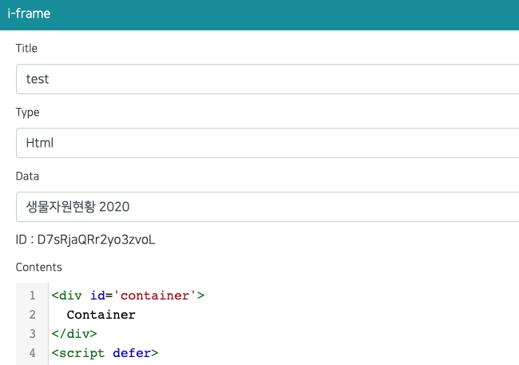

You can make custom charts and visualizations using an iframe.
You can assign **one or more data** to an iframe and use all of them inside the iframe.
It works the same way in the editor and in the published site.



## Assign data

In the iframe popup, choose one or more items in the **Data** field (multiple selection).
If you do not select any data, the iframe receives no data.

### GIS data (map boundaries)

You can also assign one or more **GIS data** (a GeoJSON / Shapefile you uploaded as GIS data) in the **GIS Data** field.
Use it to draw regions on a map, for example a choropleth that colors provinces by a value from the assigned data.

## Message protocol

1. The iframe asks the parent page for data with `postMessage`.

   ```js
   window.parent.postMessage("IFRAME_DATA_REQ,__IFRAME_ID_HERE__");
   ```

2. The parent page loads **all assigned data**, combines them and sends **one** message to the iframe.
   The same message is sent again whenever any of the assigned data is refreshed.

   ```js
   {
     type: "IFRAME_DATA_RES",

     // All assigned data (in the order of assignment)
     datasets: [
       { _dataId: "xxx", name: "Sales", success: true, columns: [...], rows: [...] },
       { _dataId: "yyy", name: "Users", success: false, error: "error message" }
     ],

     // Assigned GIS data (boundaries). Always present, possibly empty
     gis: [
       { _gisDataId: "zzz", name: "Provinces", success: true, featureCount: 17, bbox: [124.6, 33.1, 131.9, 38.6], simplified: false, geojson: { type: "FeatureCollection", features: [...] } }
     ],

     // Only the data that failed to load (empty array if everything succeeded)
     errors: [
       { _dataId: "yyy", name: "Users", error: "error message" }
     ],

     // For backward compatibility: columns/rows of the first successful dataset
     columns: [...],
     rows: [...]
   }
   ```

   | Field | Description |
   | --- | --- |
   | `datasets[].success` | `true` if the data was loaded, `false` if it failed |
   | `datasets[].columns`, `datasets[].rows` | The data (only when `success` is `true`) |
   | `datasets[].error` | The failure reason (only when `success` is `false`) |
   | `gis[].geojson` | A GeoJSON `FeatureCollection` of the GIS data. Coordinates are rounded to 5 decimals and simplified when the data is large (`simplified: true`) |
   | `gis[].featureCount`, `gis[].bbox` | Number of features and the extent `[minLng, minLat, maxLng, maxLat]` |
   | `gis[].success`, `gis[].error` | `false` with the reason when the GIS data could not be loaded |
   | `errors` | The list of failed datasets |
   | `columns`, `rows` | First successful dataset. Existing iframes that use a single data keep working without any change |

:::info
Data that fails to load (for example, no permission or a connection error) does not block the other data.
Failed data is delivered together with its error in `datasets` / `errors`.
:::

## Example: show several data in one iframe

```html
<div id='container'>
  Loading...
</div>
<script defer>
  function render(msg){
    const container = document.getElementById('container');
    let html = '';

    // Failed data
    (msg.errors || []).forEach((e) => {
      html += '<p style="color:red">' + e.name + ' : ' + e.error + '</p>';
    });

    // Draw every loaded dataset (replace this part with your own chart)
    (msg.datasets || []).filter((d) => d.success).forEach((d) => {
      html += '<h4>' + d.name + ' (' + d.rows.length + ' rows)</h4>';
      html += '<pre>' + JSON.stringify(d.columns) + '</pre>';
    });

    container.innerHTML = html;
  }

  (function(){
    window.addEventListener("message", (event)=>{
      if(event.data && event.data.type === "IFRAME_DATA_RES"){
        render(event.data);
      }
    });

    //window.parent.postMessage("IFRAME_DATA_REQ,D7sRjaQRr2yo3zvoL");
    window.parent.postMessage("IFRAME_DATA_REQ,__IFRAME_ID_HERE__");
  })();
</script>
```
:::info
change ID to your iframe id
:::

## Example: color regions with GIS boundaries

Join the data rows to the boundary features by a key (for example the region name), then draw them with Leaflet or ECharts.
Compare keys as strings: numeric-looking property values (such as `11`) are stored as numbers when the GIS data is uploaded.

```html
<link rel="stylesheet" href="/static/leaflet/leaflet.css">
<script src="/static/leaflet/leaflet.js"></script>
<div id="map" style="height:100vh"></div>
<script>
  var map = L.map('map');
  window.addEventListener('message', function (event) {
    var msg = event.data;
    if (!msg || msg.type !== 'IFRAME_DATA_RES') return;
    var rows = msg.datasets[0].rows;            // [[regionName, value], ...]
    var values = new Map(rows.map(function (r) { return [String(r[0]).trim(), r[1]]; }));
    var fc = msg.gis[0].geojson;
    var layer = L.geoJSON(fc, {
      style: function (f) {
        var v = values.get(String(f.properties.REGION_NAME).trim());
        return { fillColor: v > 1000 ? '#08519c' : '#9ecae1', fillOpacity: 0.8, weight: 1, color: '#fff' };
      }
    }).addTo(map);
    map.fitBounds(layer.getBounds());
  });
  window.parent.postMessage('IFRAME_DATA_REQ,__IFRAME_ID_HERE__');
</script>
```

Libraries hosted by the app can be loaded with absolute paths (they also work after publishing and on-premise):
`/static/echarts/echarts.min.js` (ECharts), `/static/chartjs/chart.js` (Chart.js), `/static/threejs/sclab-three.min.js` (three.js, global `SCLAB_THREE`), `/static/leaflet/leaflet.js` and `/static/leaflet/leaflet.css` (Leaflet).

## Existing iframes (single data)

Iframes created with a single data keep working as before.
`data.columns` and `data.rows` are still delivered, so no code change is required.
To use the new feature, read `data.datasets` instead.

## API

When you create or update an iframe with the REST API, use `_dataIds` (array of data ids).
The old `_dataId` (single id) is still accepted.
