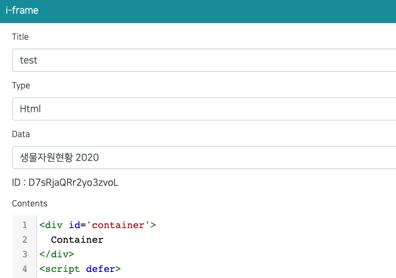

iframe 으로 커스텀 차트나 시각화를 만들 수 있습니다.
iframe 에는 **하나 이상의 데이터**를 할당할 수 있으며, 할당된 모든 데이터를 iframe 안에서 함께 사용할 수 있습니다.
에디터와 퍼블리시된 사이트에서 동일하게 동작합니다.



## 데이터 할당

iframe 팝업의 **Data** 항목에서 데이터를 하나 이상 선택합니다. (다중 선택)
데이터를 선택하지 않으면 iframe 으로 전달되는 데이터가 없습니다.

### GIS 데이터 (지도 경계)

**GIS Data** 항목에서 **GIS 데이터**(GIS 데이터로 업로드한 GeoJSON / Shapefile)도 하나 이상 할당할 수 있습니다.
지도 위에 지역 경계를 그릴 때 사용합니다. 예를 들어 할당한 데이터의 값으로 시도별 색을 칠하는 단계 구분도(코로플레스)를 만들 수 있습니다.

## 메시지 규약

1. iframe 이 부모 페이지에 `postMessage` 로 데이터를 요청합니다.

   ```js
   window.parent.postMessage("IFRAME_DATA_REQ,__IFRAME_ID_HERE__");
   ```

2. 부모 페이지는 **할당된 모든 데이터**를 가져와 하나로 합친 뒤 iframe 으로 **한 번에** 전송합니다.
   할당된 데이터 중 하나라도 갱신되면 같은 형식의 메시지를 다시 전송합니다.

   ```js
   {
     type: "IFRAME_DATA_RES",

     // 할당된 모든 데이터 (할당 순서)
     datasets: [
       { _dataId: "xxx", name: "Sales", success: true, columns: [...], rows: [...] },
       { _dataId: "yyy", name: "Users", success: false, error: "오류 메시지" }
     ],

     // 할당된 GIS 데이터(경계 등). 항상 있으며 비어 있을 수 있음
     gis: [
       { _gisDataId: "zzz", name: "시도 경계", success: true, featureCount: 17, bbox: [124.6, 33.1, 131.9, 38.6], simplified: false, geojson: { type: "FeatureCollection", features: [...] } }
     ],

     // 가져오기에 실패한 데이터만 모은 목록 (모두 성공하면 빈 배열)
     errors: [
       { _dataId: "yyy", name: "Users", error: "오류 메시지" }
     ],

     // 하위 호환용: 첫 번째로 성공한 데이터의 columns/rows
     columns: [...],
     rows: [...]
   }
   ```

   | 필드 | 설명 |
   | --- | --- |
   | `datasets[].success` | 데이터를 가져왔으면 `true`, 실패했으면 `false` |
   | `datasets[].columns`, `datasets[].rows` | 데이터 (`success` 가 `true` 일 때만) |
   | `datasets[].error` | 실패 사유 (`success` 가 `false` 일 때만) |
   | `gis[].geojson` | GIS 데이터의 GeoJSON `FeatureCollection`. 좌표는 소수 5자리로 반올림되고, 데이터가 크면 단순화됩니다(`simplified: true`) |
   | `gis[].featureCount`, `gis[].bbox` | 피처 수와 범위 `[minLng, minLat, maxLng, maxLat]` |
   | `gis[].success`, `gis[].error` | GIS 데이터를 가져오지 못하면 `false` 와 실패 사유 |
   | `errors` | 실패한 데이터 목록 |
   | `columns`, `rows` | 첫 번째로 성공한 데이터. 단일 데이터를 쓰는 기존 iframe 은 수정 없이 그대로 동작합니다 |

:::info
권한이 없거나 연결 오류 등으로 가져오지 못한 데이터가 있어도 나머지 데이터는 정상적으로 전달됩니다.
실패한 데이터는 실패 사유와 함께 `datasets` / `errors` 로 전달됩니다.
:::

## 예제: 여러 데이터를 한 iframe 에서 표시

```html
<div id='container'>
  Loading...
</div>
<script defer>
  function render(msg){
    const container = document.getElementById('container');
    let html = '';

    // 실패한 데이터
    (msg.errors || []).forEach((e) => {
      html += '<p style="color:red">' + e.name + ' : ' + e.error + '</p>';
    });

    // 가져온 모든 데이터를 그린다 (이 부분을 원하는 차트 코드로 교체)
    (msg.datasets || []).filter((d) => d.success).forEach((d) => {
      html += '<h4>' + d.name + ' (' + d.rows.length + ' rows)</h4>';
      html += '<pre>' + JSON.stringify(d.columns) + '</pre>';
    });

    container.innerHTML = html;
  }

  (function(){
    window.addEventListener("message", (event)=>{
      if(event.data && event.data.type === "IFRAME_DATA_RES"){
        render(event.data);
      }
    });

    //window.parent.postMessage("IFRAME_DATA_REQ,D7sRjaQRr2yo3zvoL");
    window.parent.postMessage("IFRAME_DATA_REQ,__IFRAME_ID_HERE__");
  })();
</script>
```
:::info
ID를 사용하는 iframe 의 ID로 변경하세요.
:::

## 예제: GIS 경계로 지역 색칠하기

데이터 행과 경계 피처를 키(예: 지역 이름)로 연결한 뒤 Leaflet 이나 ECharts 로 그립니다.
키는 문자열로 비교하세요. GIS 데이터를 업로드할 때 `11` 처럼 숫자로 보이는 속성 값은 숫자로 저장됩니다.

```html
<link rel="stylesheet" href="/static/leaflet/leaflet.css">
<script src="/static/leaflet/leaflet.js"></script>
<div id="map" style="height:100vh"></div>
<script>
  var map = L.map('map');
  window.addEventListener('message', function (event) {
    var msg = event.data;
    if (!msg || msg.type !== 'IFRAME_DATA_RES') return;
    var rows = msg.datasets[0].rows;            // [[지역명, 값], ...]
    var values = new Map(rows.map(function (r) { return [String(r[0]).trim(), r[1]]; }));
    var fc = msg.gis[0].geojson;
    var layer = L.geoJSON(fc, {
      style: function (f) {
        var v = values.get(String(f.properties.REGION_NAME).trim());
        return { fillColor: v > 1000 ? '#08519c' : '#9ecae1', fillOpacity: 0.8, weight: 1, color: '#fff' };
      }
    }).addTo(map);
    map.fitBounds(layer.getBounds());
  });
  window.parent.postMessage('IFRAME_DATA_REQ,__IFRAME_ID_HERE__');
</script>
```

앱이 서버에 가지고 있는 라이브러리는 절대 경로로 불러올 수 있습니다(발행 후, 온프레미스에서도 동작합니다):
`/static/echarts/echarts.min.js`(ECharts), `/static/chartjs/chart.js`(Chart.js), `/static/threejs/sclab-three.min.js`(three.js, 전역 `SCLAB_THREE`), `/static/leaflet/leaflet.js`와 `/static/leaflet/leaflet.css`(Leaflet).

## 기존 iframe (단일 데이터)

데이터를 하나만 할당해 만든 기존 iframe 은 그대로 동작합니다.
`data.columns`, `data.rows` 가 여전히 전달되므로 코드를 수정할 필요가 없습니다.
새 기능을 쓰려면 `data.datasets` 를 사용하세요.

## API

REST API 로 iframe 을 생성/수정할 때는 `_dataIds`(데이터 id 배열)를 사용합니다.
기존 `_dataId`(단일 id)도 계속 사용할 수 있습니다.
